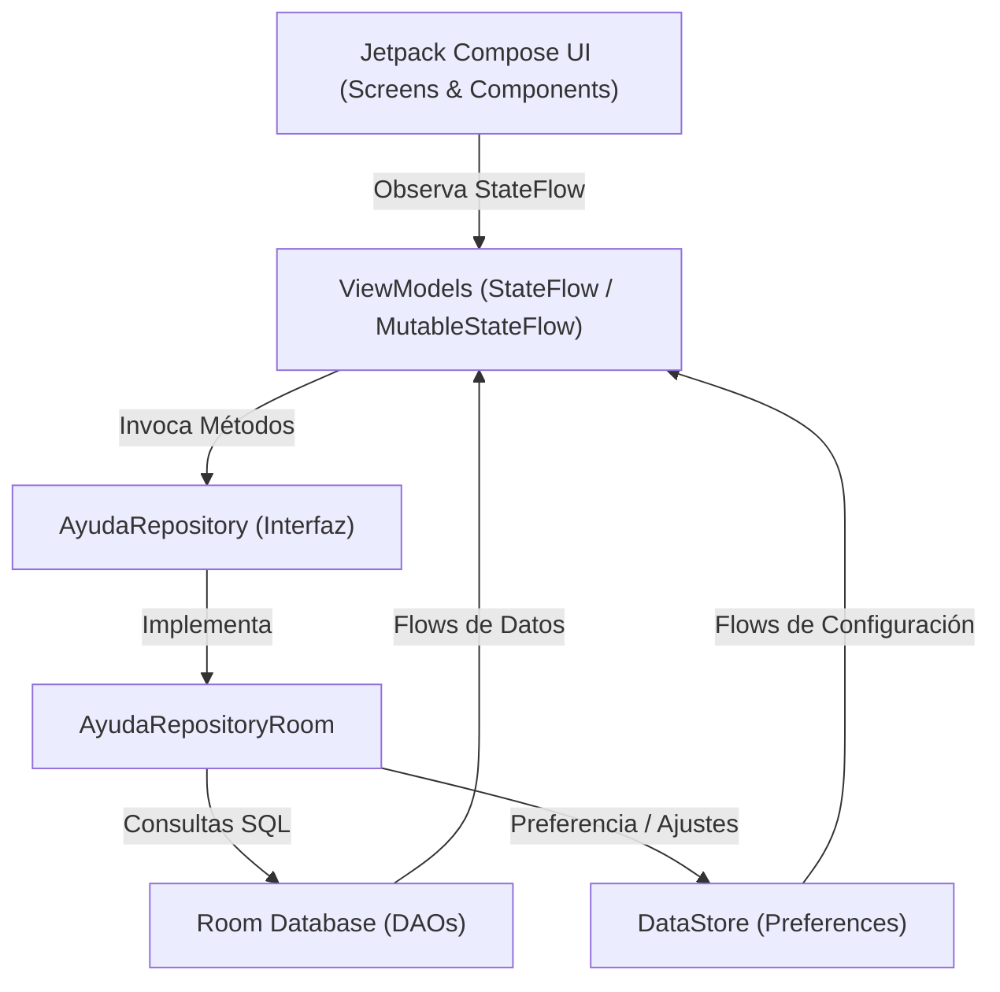

## Nombre: HelpCampus - Mesa de Ayuda TI

**Descripcion:** AyudaCampus es una Aplicación móvil desarrollada en **Android con Jetpack Compose, MVVM, Room y DataStore** para la gestión de tickets de soporte técnico técnico en el campus universitario. Permite a los estudiantes reportar incidencias y al personal de TI atenderlas y analizarlas en tiempo real.

---

### 📁 Árbol de Paquetes

```text
com.carbajal.ayudacampus
│
├── data
│   ├── local
│   │   ├── dao (CategoriaDao, TicketDao, UsuarioDao)
│   │   ├── entity (Categoria, Comentario, Ticket, Usuario)
│   │   ├── relation (TicketConDetalle)
│   │   ├── AyudaDatabase.kt
│   │   └── DatosIniciales.kt
│   ├── prefs
│   │   └── PreferenciasStore.kt (DataStore)
│   └── repository
│       ├── AyudaRepository.kt (Interface)
│       └── AyudaRepositoryRoom.kt
│
├── model (ConteoCategoria, EstadoTicket, Prioridad, Rol)
│
├── ui
│   ├── cliente (LoginScreen, MisTicketsScreen, NuevoTicketScreen, DetalleTicketScreen, PerfilScreen)
│   ├── soporte (PanelScreen, BandejaScreen, AtenderTicketScreen, CategoriasScreen, FormularioCategoriaScreen, AjustesScreen)
│   ├── components (AyudaButton, AyudaTextField, BurbujaComentario, EstadoChip, PrioridadChip, StepperTicket, TicketCard, Estrellas, graficos)
│   ├── navigation (NavAyuda, Rutas)
│   └── theme (Theme, Color, Type)
│
└── viewmodel (SesionViewModel, MisTicketsViewModel, NuevoTicketViewModel, TicketDetalleViewModel, PanelViewModel, BandejaViewModel, AtenderViewModel, CategoriasViewModel, AyudaViewModelFactory)
```

---

## 🏗️ Diagrama de Arquitectura MVVM



---

## 📸 Capturas de Pantalla

### 👤 Perfil Estudiante (Cliente)
| 1. Perfil | 2. Mis Tickets | 3. Nuevo Ticket |
| :---: | :---: | :---: |
||||


### 🛠️ Perfil Soporte TI (Admin)
| 4. Panel de Ajustes | 5. Panel de Soporte | 6. Atender Ticket |
| :---: | :---: | :---: |
||||

---

### 🧠 Respuestas de las preguntas para pensar'

* **1. Reglas en ViewModel:** El ViewModel concentra la lógica de negocio y validaciones de estado para mantener los Composables limpios y no sobrecargar al DAO con reglas que no son de almacenamiento.
* **2. suspend vs Flow:** `crearTicket` es una operación puntual de una sola ejecución (`suspend`), mientras que `observarTicket` transmite actualizaciones constantes en tiempo real (`Flow`).
* **3. Cierre sin calificación:** Se perderían métricas de calidad del servicio y se cerrarían incidencias sin la confirmación del estudiante sobre si el problema se resolvió realmente.
* **4. Migración a servidor:** Solo se crearía una nueva implementación del repositorio (`AyudaRepositoryRemote`) usando Retrofit/Ktor, sin necesidad de modificar los ViewModels ni la interfaz visual.

---
